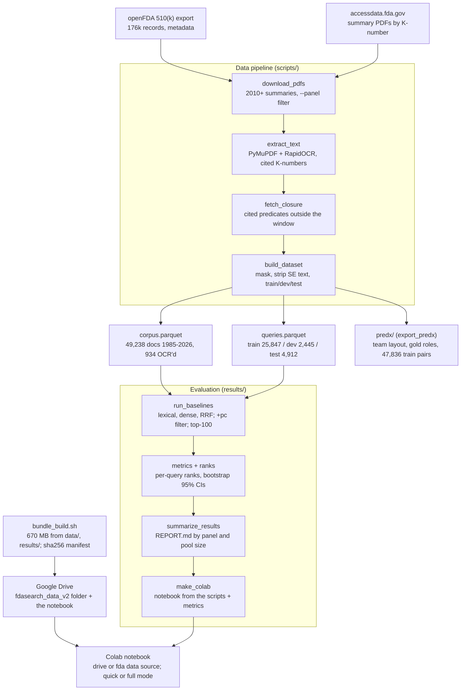

# fdasearch design

2026-11-21 · Keyvan Azami (with Claude Code). Living copy: https://claude.ai/artifact/A4s1wKE1N661PFdsZhALsB

## Goal

fdasearch turns the public FDA 510(k) record into a predicate-retrieval benchmark and measures how well untuned search methods solve it. Given a new device's text (name, Indications for Use, device description), the system must rank the 49,238 earlier clearances so that the predicates its 510(k) summary cites come first. The project delivers the dataset (v2, in the team's `predx` layout), 16 zero-shot baselines with confidence intervals, and a Colab notebook that reruns everything from a data bundle on Google Drive.

- **Query**: one 510(k) subject cleared in 2024 (dev) or 2025 to 2026 (test), its text with K-numbers masked and substantial-equivalence sentences removed.
- **Candidates**: every corpus device cleared before the subject's decision date; optionally only those sharing its product code (`+pc`).
- **Positives**: the K-numbers the subject's summary cites as predicates, when they are in the corpus. The first cited one is the primary predicate.
- **Train split**: 25,847 subjects from 2010 to 2023 with 47,836 (query, predicate) pairs for fine-tuning; never evaluated on.

## System overview

Metadata and PDFs enter at the top, four scripts turn them into the corpus, query and predx files, the evaluation scripts score and report, and the bundle plus notebook let anyone rerun the lower half from Drive.

## Data pipeline

Five scripts take the openFDA export to a leak-controlled dataset; each stage is resumable and writes one file the next stage reads.

| Stage | Script | Input | Output | Notes |
| --- | --- | --- | --- | --- |
| 1. Metadata + PDFs | `download_pdfs.py` | openFDA 510(k) export (176k records) | `data/pdfs/K######.pdf` for 2010+ summaries | Generic research User-Agent; ~25 PDFs/s with 6 workers; 0.6% have no PDF. `--panel` restricts to one advisory committee. |
| 2. Text extraction | `extract_text.py` | PDFs | `data/extracted.jsonl` | PyMuPDF text; regex section headers for Indications for Use and Device Description; cited K-numbers labelled predicate or reference by nearby wording. Pages under 100 characters trigger RapidOCR on the GPU (150 dpi, first 12 pages, 0.65 s/page on the 4090). OCR recovered 775 of 990 scanned 2010+ summaries. |
| 3. Closure fetch | `fetch_closure.py` | cited K-numbers missing from the corpus | `data/pdfs_closure/` + `extracted_closure.jsonl` | Pulls the mostly pre-2010 predicates the queries cite so they count as retrievable: 1,021 PDFs fetched, 298 not on the FDA server, 101 needed OCR. Single worker with back-off because FDA throttles bursts. |
| 4. Dataset build | `build_dataset.py` | metadata + both extracted files | `data/corpus.parquet`, `data/queries.parquet` | Masks K-numbers, drops sentences mentioning predicates, substantial equivalence, 510(k) or reference devices (52,776 sentences), flags queries whose predicate's name appears verbatim (`leak_name`, 24%). Splits by decision year: train 2010-2023, dev 2024, test 2025+. |
| 5. Team export | `export_predx.py` | the two parquet files | `data/predx/*.jsonl.gz`, `dataset_card.json` | The `predx` layout from the team notebook: corpus, per-split queries with gold roles (primary/additional), train pairs, dataset card. |

Retrieval text per document is `device_name + IFU + description` (97% of docs); when neither section parses, the first 4,000 characters of the summary body stand in. Corpus v2 has 49,238 documents from 1985 to 2026, of which 934 are OCR'd. Dev and test queries find 96% and 97% of their cited predicates in the corpus; v1, which lacked closure and OCR, found about 82%.

## Retrieval baselines and evaluation

`run_baselines.py` scores every dev and test query against the whole corpus with one method at a time, applies the candidate filter, and writes per-query ranks plus a top-100 list that later fusion runs reuse.

| Family | Methods | How |
| --- | --- | --- |
| Trivial | random, pop | pop ranks same-product-code devices by how often they were cited as predicates before the query date, recency as tie-break |
| Lexical | TF-IDF (1-2 grams, cosine), BM25 (bm25s + stemming), LSA (SVD-300 over TF-IDF) | fit on the corpus, no tuning |
| Dense, local | MiniLM-L6, bge-base, e5-base, gte-modernbert, bge-m3, Qwen3-Embedding 0.6B and 4B | sentence-transformers on the 4090, 512-token limit, model-specific query prompts, vectors cached per K-number |
| Dense, Ollama | embeddinggemma, nomic-embed-text | local Ollama server (EmbeddingGemma weights are gated on Hugging Face) |
| Dense, API | gemini-embedding-001 (3072-d) | google-genai, retries absorb the free-tier 429s |
| Hybrid | `rrf:a\|b` | reciprocal-rank fusion (k = 60) of two saved top-100 lists, e.g. TF-IDF with each dense model |

**Candidate filtering.** A candidate must be cleared before the subject and is never the subject itself. The `+pc` variant also requires the same product code; it is scored for every method because the FDA search UI works that way.

**Metrics.** Recall@10 (share of a query's positives in the top 10), Hit@1, Hit@10, Hit@100, MRR, and the same for the primary predicate alone. Positives excluded by a filter count as not retrieved. Every number carries a 95% bootstrap interval over queries (1,000 resamples). `summarize_results.py` renders the report with breakdowns by review panel and by how many same-code candidates a query has.

**Label check.** On 100 random 2024-2026 summaries, gemma4:31b on a Spark was asked for the predicate K-numbers: the regex primary predicate agreed in 91% of summaries, and across all cited K-numbers the regex labels had precision 0.70 and recall 0.93 against the LLM. Over-inclusion is mostly reference devices and the applicant's own prior clearances, so all scores are lower bounds and the primary-only metrics are the cleanest.

## Results snapshot

TF-IDF ties the best fusion at about 70% Recall@10 on the 4,912 test queries, and no untuned embedder beats it; the full table with intervals is in `results/REPORT.md`.

| Method (test, v2) | Recall@10 % | Hit@1 % | Hit@100 % |
| --- | --- | --- | --- |
| RRF TF-IDF + Gemini | 69.9 | 48.4 | 96.1 |
| TF-IDF | 69.3 | 49.7 | 95.4 |
| RRF TF-IDF + EmbeddingGemma | 69.1 | 48.4 | 96.0 |
| BM25 | 65.4 | 47.3 | 93.3 |
| Gemini embedding-001 | 65.1 | 45.3 | 94.2 |
| EmbeddingGemma-300M | 62.9 | 45.4 | 93.1 |

- Lexical search wins zero-shot. Predicate summaries reuse the subject's exact vocabulary (model names, standards, materials), which n-grams catch and general-purpose embeddings blur.
- Fusion helps the tail, not the head: Hit@100 rises to 96% while Hit@1 is unchanged, so the first-stage recall for a fine-tuned reranker is already high.
- Product-code restriction costs 2 to 4 points of Recall@10 everywhere because about a tenth of positives sit outside the subject's product code.
- Bigger is not better untuned: Qwen3-Embedding-4B (58.1) trails MiniLM-L6 on Hit@1; the task needs domain adaptation, not scale.
- v2 is uniformly 1.2 to 2.4 points harder than v1 for every method and the ranking is unchanged: pre-2010 predicates now count as positives, 934 scans were OCR'd, and substantial-equivalence sentences were stripped.
- Dev and test agree within a point on every method, so dev is a trustworthy selection set for fine-tuning on the train pairs.

## Reproducibility

Anyone with the Drive folder and the notebook can rerun the benchmark without touching FDA servers or the original machine.

**Colab notebook** (`notebooks/fdasearch_510k_baselines.ipynb`, generated by `scripts/make_colab.py`). The seven pipeline scripts are embedded as write-file cells, so the notebook runs the exact code behind the reported numbers and is regenerated whenever a script changes. Two switches: `DATA_SOURCE` (`drive` reads the bundle; `fda` rebuilds from openFDA and accessdata.fda.gov) and `MODE` (`quick` = one advisory committee, about 6k documents, roughly 10 minutes on a T4; `full` = all panels, 20 to 40 minutes per dense model). Dense models download from Hugging Face; EmbeddingGemma needs an `HF_TOKEN` Colab secret, Gemini a `GEMINI_API_KEY` secret, and both are skipped when absent. A final cell compares the run against the shipped reference metrics.

**Data bundle** (`fdasearch_data_v2` on Drive, 670 MB, built by `bundle_build.sh`): the openFDA export, both extracted-text files gzipped, the corpus and query tables, the `predx` export, the reference metrics and report, and a `manifest.json` with a sha256 per file that the notebook verifies.

**Local environment.** Windows 11 with an RTX 4090; `.venv` has CUDA torch 2.11, sentence-transformers, bm25s and RapidOCR on onnxruntime-gpu 1.22. Ollama serves embeddinggemma, embeddinggemma-2:740m and nomic-embed-text. Two DGX Spark boxes reachable over ssh run Ollama with gemma4:31b for the label check. The Gemini key lives in `.env`, which is git-ignored along with all data and run artifacts.

**Repository.** The code lives under `fdasearch/` on the branch `fdasearch-baselines` of the fork keyvanazami/predicate-data-pipeline, proposed to the team repo as draft PR schukka28/predicate-data-pipeline#1; data, embedding caches, bundle and secrets are excluded.

## Limitations and next steps

The labels are regex-derived and the texts are what PyMuPDF and OCR could read, so every score is a lower bound on a cleaner benchmark.

- **Label noise.** 9% of primary predicates and 30% of all cited K-numbers disagree with an LLM read. A cheap fix is to run the gemma4 labeller over all 7,357 dev and test summaries and keep both label sets.
- **Name leakage.** 24% of queries still contain a predicate's device name verbatim after sentence stripping (often the applicant's own product line). Report metrics with and without those queries.
- **Coverage.** 3% to 4% of cited predicates are outside the corpus (no PDF on the FDA server, or unreadable scans); 298 closure PDFs returned 404.
- **Team parser.** The `predx` package is public at github.com/schukka28/predicate-data-pipeline; on 3,089 sampled 2010+ digital PDFs the two parsers pick the same primary predicate 95.9% of the time and the same gold set 81.7%; against the LLM labels predx scores precision 0.71 / recall 0.95 versus 0.70 / 0.93 here, and it finds a description for 94.8% of documents versus 80.5%, so its parser should replace this one (`results/parse_agreement.md`).
- **Untested paths.** The notebook has not yet completed a run inside Colab itself, and the one-panel `fda` rebuild path has only run on the original machine.

Next steps, in order: fine-tune bge-m3 or EmbeddingGemma on the 47,836 train pairs with hard negatives from the TF-IDF top-100 and select on dev; add a cross-encoder reranker over the fused top-100; score embeddinggemma-2:740m zero-shot as a new baseline.

## Merge plan with predx

predx should own the data pipeline and fdasearch should contribute only what predx lacks: GPU extraction, the dense and hybrid baselines, and the Drive-backed Colab. Everything else in fdasearch duplicates a tested predx stage and should be retired.

| Stage | predx | fdasearch | Keep |
| --- | --- | --- | --- |
| Metadata, queues, fetch | `meta`, `plan` (pilot / subjects / closure / full), `fetch` with status log, 4 req/s, resumable | `download_pdfs.py`, `fetch_closure.py` | predx. Add a `--panel` filter to `plan`, the one thing it lacks. |
| Text extraction | pdftotext + tesseract, 300 dpi, ~4 CPU-s per doc, never run on real FDA PDFs at scale | PyMuPDF + RapidOCR on GPU, 0.65 s per page, already run on all 49k docs | predx's on-disk format, fdasearch's engine: add a PyMuPDF/RapidOCR backend to `text_stage` (or a converter into `data/text/<yy>/K.txt.gz` + `text_stats.jsonl`). |
| Sections and predicate labels | form-page IFU preference, section end rules, role labels with a 260-char window, 73 tests incl. 10 real PDFs | simpler regexes | predx: measured on 3,089 sampled documents it agrees with fdasearch on 95.9% of primaries, scores slightly better against the LLM labels (0.71 / 0.95 vs 0.70 / 0.93) and finds descriptions for 94.8% vs 80.5%. |
| Dataset build | `build` + `validate` + `audit` (PASS/WARN/FAIL), device funnel, mask levels | `build_dataset.py`, `export_predx.py` | predx, configured: `splits.train` from 2010, `mask_level: strict` (equals fdasearch's SE stripping). Retire both fdasearch scripts. |
| Baselines and metrics | BM25, popularity, random on up to 3,000 sampled test queries; Recall@k, Hit@k, MRR, nDCG, bootstrap | 16 methods incl. 9 dense, Gemini, RRF; product-code variant; primary-only metrics; all dev + test queries; per-panel report | fdasearch, reading the predx dataset (`n_candidates` as date filter, `gold_in_corpus` as positives); predx's BM25 stays as the audit sanity check. |
| Label check | `label-sample` / `label-eval` hand labels with Wilson CIs | 100-doc LLM check (gemma4:31b) | both; feed the LLM labels through `label-eval` so one number is reported. |
| Notebook | `predx_colab_test.ipynb` smoke tests | baselines Colab with Drive bundle | fdasearch, pointed at the predx dataset. |
| Infrastructure | GCP Spot VM, GCS sync, optional BigQuery | local RTX 4090, two Sparks, Ollama | both: CPU stages on GCP, OCR and embeddings on the GPU boxes. |

Three definitions need a team decision before the merge, because they change the numbers: train window start (2010 gives 25,847 train queries, 2015 about 20,000); whether `device_name` is part of the query text (fdasearch yes, predx no); and whether reported metrics are primary-only, all gold, or both. The first-other fallback in predx's predicate labelling should also be measured before it adds positives.

The open pull request is a snapshot of fdasearch as a parallel folder; the follow-up on the same branch should delete its download, closure and build scripts once the predx backend and the dataset reader exist.
